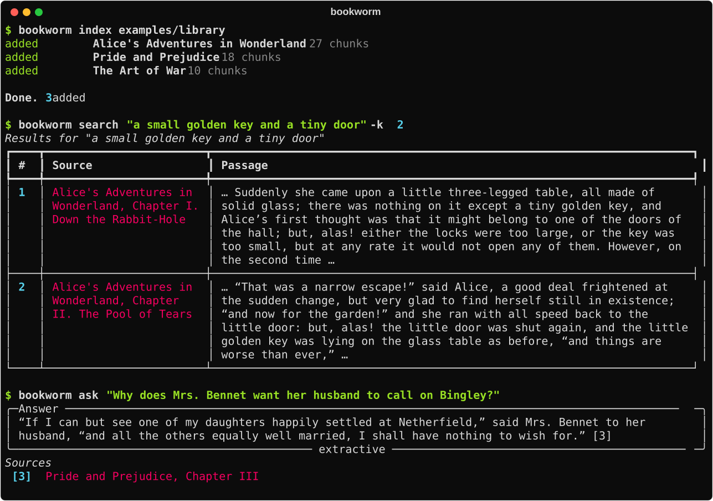
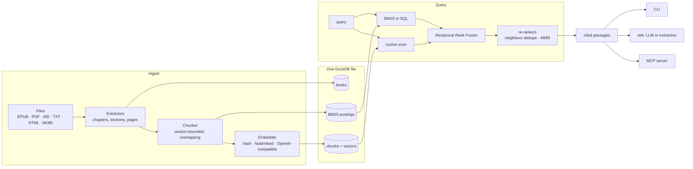

# Bookworm

**Turn a folder of ebooks into a knowledge base you can search, question and cite.**

Point Bookworm at your EPUBs, PDFs, Markdown and plain-text books. It pulls out the real structure (chapters, sections, page numbers), indexes every passage for both keyword and semantic search, and answers questions with citations that tell you exactly where to look: *Pride and Prejudice, Chapter III* or *Repair Manual, Brakes, pp. 41-42*. Agents get the same library through a built-in MCP server.

Everything lives in a single DuckDB file. It runs fully offline out of the box, and when you want stronger semantic search you can switch to a local ONNX model or any OpenAI-compatible API with one environment variable.



## Quickstart

The repo ships with a small public-domain library (three chapters of *Pride and Prejudice*, two of *Alice's Adventures in Wonderland*, three of *The Art of War*) so you can try it immediately.

```bash
git clone https://github.com/joey12725/bookworm.git
cd bookworm
uv sync                                  # or: pip install -e .

uv run bookworm index examples/library
uv run bookworm search "a small golden key and a tiny door"
uv run bookworm ask "What is the supreme excellence in war?"
uv run bookworm show "art of war"        # details and table of contents
uv run bookworm read "art of war" 3      # full text of chapter 3
```

No API key and no model download needed. Then index your own shelf:

```bash
uv run bookworm --db ~/books.duckdb index ~/Books
```

## Features

- **Reads the formats people actually have.** EPUB 2 and 3, PDF, Markdown, plain text, HTML, plus MOBI/AZW. Project Gutenberg files are cleaned automatically (license boilerplate and illustration markers stripped, title and author picked up from the header).
- **Structure-aware chunking.** Chapters come from the EPUB table of contents, PDF bookmarks, Markdown headings or `CHAPTER IV.`-style headings in text. Passages never straddle two chapters, keep their page range, and overlap by a sentence or two so ideas at a boundary stay findable.
- **Hybrid retrieval.** BM25 keyword ranking (computed in SQL over an inverted index) and vector similarity, fused with Reciprocal Rank Fusion. `"Quoted phrases"` must match verbatim. Neighbouring passages are collapsed, and MMR diversity re-ranking is one setting away.
- **Citations everywhere.** Every hit carries book, chapter, section and page. `bookworm ask` numbers its sources and cites them inline as `[1]`, `[2]`.
- **Pluggable embeddings.** A built-in hashing embedder that works offline with zero setup, `fastembed` for local ONNX models, or any OpenAI-compatible endpoint: OpenAI, OpenRouter, Ollama, LM Studio, vLLM.
- **Grounded Q&A, with or without an LLM.** With a chat model configured, answers are generated strictly from the retrieved passages. Without one, Bookworm assembles an extractive answer from the best-matching sentences.
- **Incremental re-indexing.** Unchanged files are skipped by size and mtime, moved or renamed files are re-linked by content hash, and an edited book reuses the stored vector of every passage that didn't change. `--prune` drops books you deleted.
- **MCP server for agents.** `bookworm mcp` exposes `search_library`, `ask_library`, `list_books` and `read_chapter` to Claude Desktop, Claude Code, Cursor and any other MCP client.
- **Goodreads import.** Attach your ratings and shelves from a Goodreads CSV export.
- **Scriptable.** `index`, `search`, `ask`, `books` and `stats` all speak `--json`, and the whole thing is a typed Python library.

## How it works



The pipeline in one paragraph: an **extractor** turns each file into sections with chapter titles and page numbers. The **chunker** packs whole paragraphs into roughly 320-token passages without crossing a section boundary, splitting oversized paragraphs at sentence boundaries. Each passage is embedded (reusing any vector already stored for identical text) and written to DuckDB along with its BM25 postings. At query time Bookworm scores both rankings in SQL, fuses them with RRF and hands the top passages, with citations, to the CLI, the Q&A layer or an MCP client.

More detail in [docs/architecture.md](docs/architecture.md).

## Choosing an embedder

| `BOOKWORM_EMBEDDER` | Runs | Setup | Good for |
|---|---|---|---|
| `hash` (default) | locally, offline | none | trying things out, exact and fuzzy wording, tests |
| `fastembed` | locally, ONNX | `pip install 'bookworm[fastembed]'` | real semantic search with no API key |
| `openai` / `openrouter` | API | `OPENAI_API_KEY` / `OPENROUTER_API_KEY` | best quality |
| `ollama` | local server | `ollama pull nomic-embed-text` | private semantic search on your own GPU |
| `openai-compatible` | anywhere | `BOOKWORM_EMBED_BASE_URL` + `BOOKWORM_EMBED_MODEL` | LM Studio, vLLM, llama.cpp, gateways |

The index remembers which embedder built it. After switching, run `bookworm reindex` to re-embed every passage. Full settings reference: [docs/configuration.md](docs/configuration.md).

## Grounded answers with an LLM

```bash
export BOOKWORM_CHAT_PROVIDER=openai      # or openrouter, ollama
export OPENAI_API_KEY=...
uv run bookworm ask "How does Sun Tzu think about the cost of a long campaign?"
```

The model receives the retrieved passages as numbered sources and is instructed to cite every claim and to say so when the books don't contain the answer.

## Use it from an agent (MCP)

Add Bookworm to any MCP client. For Claude Desktop, in `claude_desktop_config.json`:

```json
{
  "mcpServers": {
    "bookworm": {
      "command": "uvx",
      "args": ["--from", "git+https://github.com/joey12725/bookworm", "bookworm", "mcp"],
      "env": { "BOOKWORM_DB": "/absolute/path/to/books.duckdb" }
    }
  }
}
```

For Claude Code: `claude mcp add bookworm -e BOOKWORM_DB=$HOME/books.duckdb -- bookworm mcp`.

The server opens the library read-only, so an agent can search and read but never change your index.

## Use it from Python

```python
from bookworm import Bookworm, Settings

with Bookworm.open(Settings(db_path="books.duckdb")) as bw:
    bw.index(["examples/library"])
    for hit in bw.search("first impressions of Mr. Darcy", limit=3):
        print(hit.citation.format(), hit.text[:80])
    print(bw.ask("What is the supreme excellence in war?").text)
```

## Commands

| Command | What it does |
|---|---|
| `bookworm index [PATHS]` | Add or update books (`--dry-run`, `--force`, `--prune`, `--json`) |
| `bookworm search QUERY` | Hybrid, `--mode keyword` or `--mode vector` search, `--book` filter, `-k` results |
| `bookworm ask QUESTION` | Cited answer from the best passages |
| `bookworm books` | List the library |
| `bookworm show TITLE` | Book details and table of contents |
| `bookworm read TITLE N` | Full text of chapter N |
| `bookworm stats` | Library size, vocabulary, embedder, formats |
| `bookworm remove TITLE` | Drop a book from the index |
| `bookworm reindex` | Re-embed everything after changing embedder |
| `bookworm import-goodreads CSV` | Attach ratings and shelves |
| `bookworm backup DEST` / `restore SRC` | Copy the database out and back |
| `bookworm mcp` | Run the MCP server on stdio |
| `bookworm config` | Show effective settings (secrets masked) |

Titles are matched forgivingly: `bookworm read "art of war" 2` finds *The Art of War*.

## Development

```bash
uv sync
uv run pytest            # 90+ tests, no network, no model downloads
uv run ruff check src tests scripts
uv run mypy              # strict
uv run python scripts/render_demo.py   # regenerate docs/demo.svg
```

Tests build their own EPUB and PDF fixtures on the fly and use fake providers, so the suite runs in a few seconds. Adding a format, an embedder or a re-ranker is a small, well-defined job: see [docs/extending.md](docs/extending.md).

**Tech stack:** Python 3.11+, DuckDB, Click, Rich, HTTPX. Optional: pypdf, mobi, fastembed. EPUB, HTML and Markdown parsing use only the standard library.

## License

MIT. The sample texts in `examples/library` are in the public domain.

Built by [Joey Hersh](https://github.com/joey12725).
